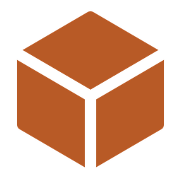

# G-Path

  

  <a href="#português">Português</a> · <a href="#english">English</a>

## Português

Ferramenta de visualização e simulação 3D de programas G-code, para usinagem e deposição (WAAM).

### Instalação

1. Baixe o `.exe` [**Releases**](https://github.com/eriksnna/g-path/releases);
2. Abra o `G-Path.exe`. Não precisa instalar Python nem nenhuma dependência.

> ⚠️ Na primeira execução, o Windows pode exibir um aviso do SmartScreen ("O Windows protegeu seu PC"), já que o executável ainda não tem assinatura digital. Clique em **"Mais informações" → "Executar assim mesmo"**.

### Como usar

1. Na tela inicial, **abra um arquivo G-code**, escolha um **recente**, **arraste um arquivo** para a janela ou **comece do zero** no editor;
2. Use a barra de reprodução para simular o percurso. A leitura no canto do visualizador mostra a posição, o avanço e se o processo está ligado;
3. Escolha o **modo** (Usinagem ou Deposição) no cabeçalho. O painel lateral mostra as estatísticas de cada modo;
4. O painel de **validação** lista os problemas do programa. Clique em um deles para ir até a linha;
5. Em **Ajustes**, configure o perfil da máquina: modo, dialeto, limites de curso e avanços.

Se o arquivo usar códigos de outro dialeto (por exemplo, M8/M9 para abrir e fechar o arco), o G-Path sugere a troca.

| Atalho | Ação |
|---|---|
| Espaço | Reproduzir ou pausar |
| ← → | Movimento anterior ou próximo |
| Shift + ← → | Camada anterior ou próxima |
| Home / End | Ir ao início ou ao fim |
| Ctrl + Enter | Aplicar o código do editor |
| Ctrl + S | Salvar |

<!-- ### Exemplos

A pasta `examples/` (incluída no `.zip`) traz 10 programas prontos:

| Arquivo | O que mostra |
|---|---|
| `machining_01_face_milling.nc` | Passadas em zigue-zague |
| `machining_02_contour_with_hole.nc` | Contorno e furo em profundidades diferentes |
| `machining_03_drilling_grid.nc` | Furação com espera (G4) |
| `machining_04_circles_g2_g3.nc` | Arcos com I/J |
| `machining_05_pocket_in_passes.nc` | Variáveis, sub-rotina e repetição |
| `machining_06_inches_incremental.nc` | Polegadas (G20) e incremental (G91) |
| `waam_01_straight_wall.nc` | Parede em 4 camadas |
| `waam_02_rectangular_frame.nc` | Quadro fechado em camadas |
| `waam_03_cylinder_in_layers.nc` | Parede cilíndrica com sub-rotina |
| `waam_04_dots_arc_m8_m9.nc` | Deposição ponto a ponto, dialeto M8/M9 |

- 10 arquivos de exemplo (6 de usinagem, 4 de deposição WAAM), com comentários em português e inglês -->

### Rodar a partir do código-fonte

Funciona em Windows, Linux e macOS, com Python 3.14.7 ou mais novo:

`pip install -r requirements.txt`
`cd src`
`python main.py`

Testes: `pip install -r requirements-dev.txt` e `python -m pytest`, dentro de `src/`.

### Créditos e licença

G-Path é distribuído sob a licença [MIT](LICENSE). Bibliotecas de terceiros: veja [THIRD-PARTY-LICENSES.txt](THIRD-PARTY-LICENSES.txt).
Ícones: [Phosphor Icons](https://phosphoricons.com) — MIT License, © Phosphor Icons.

## English

3D visualization and simulation tool for G-code programs, for machining and deposition (WAAM).

### Installation

1. Download the latest `.exe` from the [**Releases**](https://github.com/eriksnna/g-path/releases) tab;
2. Run `G-Path.exe`. No Python or other dependency is needed.

> ⚠️ On first run, Windows may show a SmartScreen warning ("Windows protected your PC"), since the executable is not digitally signed yet. Click **"More info" → "Run anyway"**.

### How to use

1. On the start screen, **open a G-code file**, pick a **recent** one, **drag a file** into the window or **start from scratch** in the editor;
2. Use the playback bar to simulate the toolpath. The readout in the viewer corner shows the position, the feed and whether the process is on;
3. Choose the **mode** (Machining or Deposition) in the header. The side panel shows the statistics for each mode;
4. The **validation** panel lists the program's issues. Click one to jump to its line;
5. In **Settings**, configure the machine profile: mode, dialect, travel limits and feeds.

If the file uses codes from another dialect (for example, M8/M9 to turn the arc on and off), G-Path suggests switching.

| Shortcut | Action |
|---|---|
| Space | Play or pause |
| ← → | Previous or next move |
| Shift + ← → | Previous or next layer |
| Home / End | Go to start or end |
| Ctrl + Enter | Apply the editor code |
| Ctrl + S | Save |

<!-- ### Examples

The `examples/` folder (included in the `.zip`) has 10 ready-made programs: six machining programs (`machining_*`) and four WAAM deposition programs (`waam_*`). Comments in each file are in English and Portuguese. -->

### Running from source

Works on Windows, Linux and macOS, with Python 3.14.7 or newer:

`pip install -r requirements.txt`
`cd src`
`python main.py`

Tests: `pip install -r requirements-dev.txt` and `python -m pytest`, inside `src/`.

### Credits and license

G-Path is distributed under the [MIT](LICENSE) license. Third-party libraries: see [THIRD-PARTY-LICENSES.txt](THIRD-PARTY-LICENSES.txt).
Icons: [Phosphor Icons](https://phosphoricons.com) — MIT License, © Phosphor Icons.

<!-- TODO: gifs de uso aqui — abrir arquivo, reprodução da simulação, troca de modo/idioma -->

Diário de Dev 🤠👇👇

## Diário de desenvolvimento 🤠

### 21/07 — terça-feira - Definição do projeto (~6h)

**Tema:**

Modernização e acessibilidade em sistemas CNC utilizados para impressão 3D de componentes metálicos: desenvolvimento de ferramenta independente e plugin nativo para o ecossistema Mach3.

O projeto foi dividido em duas frentes complementares.

### Parte 1 - Visualizador independente 

desenvolvimento de um aplicativo nativo para visualização avançada de trajetórias G-Code em ambientes 2D e 3D.

**Objetivos:** 

- Interface moderna e intuitiva;
- Simulação de trajetórias de impressão;
- Arquitetura escalável;
- Possibilidade de futura geração de G-Code.
	
### Parte 2 - Integração com Mach3

Desenvolvimento de um plugin nativo em C++ para o software mach3. 

**Objetivos:**

- Visualização das trajetórias em tempo real;
- Animações 2D e 3D integradas à máquina;
- Fundação para uma futura renovação da interface gráfica do sistema legado.

## Parte 1 - aplicativo independente

### 23/07 — quinta-feira - Reunião inicial com cliente (~7h)

### Cliente e orientador técnico

**[Prof. Dr. Gustavo Senna Carvalho](https://www.dief.unifi.it/vp-680-gustavo-senna.html)**

- [Manufacturing Technologies Research Laboratory](https://www.dief.unifi.it/vp-207-about.html)
- Università degli Studi Firenze (Florença - Itália)

### Objetivos definidos

**O projeto é voltado para:**

- Estudantes;
- Pesquisadores;
- Docentes;
- Instituições de ensino.

**Problemas identificados nas soluções atuais:**

- Softwares datados;
- Licenças de alto custo;
- Baixa acessibilidade para universidades.

### Objetivo principal

democratizar o acesso à tecnologia de ponta na manufatura, facilitando o uso dessas ferramentas através de interfaces modernas e introduzindo no mercado um novo projeto acessível, seguro e de alto impacto educacional.

### 24/07 — sexta-feira - Escolha das tecnologias (~6h)

**Para o aplicativo independente (parte 1):** desenvolvimento estruturado em Python, aproveitando a alta eficiência da linguagem para o processamento e parsing de arquivos de texto (G-Code). A interface gráfica de usuário (GUI) e o motor de renderização 3D serão construídos utilizando frameworks robustos do ecossistema Python (como PyQt/PySide para a estruturação nativa das janelas, operando em conjunto com PyOpenGL ou bibliotecas de visualização espacial para a renderização fluida das trajetórias de corte).

### 27/07 — segunda-feira - Primeiros testes (~8h)

- Protótipo inicial usando NumPy;
- Simulações geradas artificialmente;
- Ainda sem parser funcional de G-code;

### 1/08 — sábado e 2/08 — domingo - Implementação do parser (~12h)

1. **Remoção do protótipo**

- Removido o `plot_mock_gcode`;
- Removida geração de espiral com NumPy;

2. **Implementação do ``GCodeParser``**

**Funcionalidades**

- remoção de comentários (; e ( ... ));
- normalização das linhas;
- extração de pares letra + número (X10.5, G1, F300);
- controle de estado modal;
- suporte a: 
  - (G0/G1/G2/G3), 
  - coordenadas absolutas ou incrementais (G90/G91) 
  - unidades (G20 polegadas / G21 mm);
- conversão de arcos G2/G3 (centro dado por I/J, plano XY) em pequenos segmentos;
- separação entre movimentos em cortes (G1/G2/G3) e rápidos (G0).

3. **Seleção de arquivos**

- adicionado diálogo para escolher o arquivo.

4. **Visualização**

- Vermelho translúcido: movimentos rápidos;
- Azul: movimentos de corte.

5. **Câmera**

- Centralização automática na peça;
- Distância proporcional ao tamanho do modelo.

6. **Limpeza de cena**

- Remoção automática dos elementos anteriores ao recarregar arquvios.

7. **Status**

Exibição de:

- Quantidade de segmentos;
- Avisos do parser.

### 6/08 — quinta-feira - Reunião de acompanhamento (~2h)

**Próximos objetivos**

- [X] Trajeto animado
- [X] Melhoria na interface

### 13/08 — quinta-feira a 16/08 — domingo - Sistema de reprodução (~27h)

1. **Ajuste dos movimentos**

Antes:

- separava cortes e rápidos em duas listas, fazendo com que a ordem se perdesse no processo

Agora:

- guarda uma única lista `moves`, na sequência do arquivo, com a flag `is_cut`.

2. **Animação por cor, não por redesenho**

Substituição de redesenho por atualização de cores.

Benefícios:

- Menor consumo de processamento, mantendo a fluidez da animação;
- Melhor desempenho em arquivos grandes.

3. **Controles de mídia**

Adicionados:

- ⏮ e ⏭: vão ao início e ao fim.
- ⏪ e ⏩: retrocedem e avançam 2% do arquivo por clique.
- ▶ / ⏸: reproduzem ou pausam. Ao chegar ao fim, o próximo clique recomeça do zero.
- Timeline: arrastar a barra pausa a reprodução e posiciona o trajeto.
- Velocidade: 0.5x, 1.0x, 1.5x e 2.0x, aplicados em tempo real.

Recursos adicionais:

- Timeline interativa;
- Controle de velocidade:
  - 0.5x
  - 1.0x
  - 1.5x
  - 2.0x

4. **Tempo adaptativo**

- Arquivos grandes: ~15 segundos;
- Arquivos pequenos: duração mínima automática.

5. **Interface**

- Tema escuro;
- barra de reprodução destacada;
- cabeçalho com o nome do arquivo;
- linha de status.

**Limitações**

   - Todas as linhas usam a mesma espessura. O `GLLinePlotItem` aceita apenas uma largura por item, então os rápidos não aparecem mais finos que os cortes.
   - Reprodução baseada em movimentos, não em tempo real de máquina.

### 20/08 — quinta-feira - Tempo real e melhorias visuais (~6h)

1. **Adição de espessuras independentes**

Agora cada tipo de movimento virou uma camada própria, um ``GLLinePlotItem`` com sua espessura. Rápidos usam ``RAPID_WIDTH`` e cortes usam ``CUT_WIDTH``.

2. **Tempo real proporcional** 

O parser calcula a duração de cada movimento como `distância / velocidade`. Para cortes, a velocidade é o `F` modal, convertido para mm/min quando o arquivo está em G20. Para G0, usa-se `RAPID_FEED`. Os arcos são divididos em pequenos segmentos, e cada um recebe o seu tempo. A animação passa a ser controlada por tempo acumulado (`cum_start` e `cum_end` 😳), e a cabeça da ferramenta é interpolada dentro de cada movimento, então ela desliza em vez de pular de ponto em ponto.

3. **Controle de velocidade mais preciso** 

Novas Velocidades:

- 0.5x
- 1x
- 1.5x
- 2x
- 4x

4. **Novo painel de status** 

Exibição de:

- Movimento atual;
- Tempo decorrido;
- Tempo total no formato mm:ss;
- Velocidade.
	
### 21/08 — sexta-feira a 28/08 — sexta-feira - Refatoração GERAL (~35h)

**Principais mudanças**

- Refatoração completa do projeto;
- Separação por módulos;
- Melhor organização e manutenção do código.

	Deu trabalho 😥😥😭😭

### 3/09 — quinta-feira - Correções e testes (~4h)

**Atividades**

- Correção de pequenos bugs 🐛;
- realização de testes;
- validação geral do sistema.

### 11/09 — sexta-feira e 12/09 — sábado - Estatísticas e monitoramento (~10h)

1. **Adição de painel com estatísticas**

Cálculos ao abrir o arquivo: 

- tempo total;
- tempo de corte;
- tempo rápido;
- número de camadas;
- quantidade de movimentos;
- dimensões da peça.

2. **Estatísticas de Simulação**

Atualização em tempo real:

- barra de progresso;
- percentual concluído;
- movimento atual; 
- tempo restante;
- tempo decorrido.

3. **Sistema de avisos**

- lista completa dos problemas encontrados no parser.

### 17/09 — quinta-feira a 21/09 — segunda-feira - Validações e sistema de Issues (~26h)

1. **Novo sistema de Issues**

Antes: 

`parse_gcode` devolvia strings

Agora:

passa a devolver `Issue(line, severity, message)`

Cada `Move` guarda a linha de origem.

2. **Novas validações**

Implementadas verificações para:

- avanço `F` ausente
- arco com `R` (agora um erro com número de linha)
- movimento fora da área de trabalho (`MACHINE_LIMITS`).

3. **Navegação por problemas**

Ao clicar em um problema:

- A reprodução salta para o ponto correspondente;
- O código relacionado é destacado.

4. **visualização por profundidade**

Novidades:

- Colorização dos cortes por eixo Z;
- Filtro de visualização por camada.

5. **estabilidade e manutenção**

- Correção de bugs 🐛;
- execução de bateria de testes.

### 24/09 — quinta-feira - Ajuste e responsividade na interface (~4h)

1. **Adição de scroll no painel**

2. **Responsividade dos números dentro dos cards**

### 26/09 — sábado - Aprofundamento no painel de estatísticas (~3h)

1. **Mais detalhamento no painel de estatísticas**

-  O cartão agora mostra o número de comandos de movimento;
-  O detalhe mostra a divisão por tipo, como ``G0 1 | G1 1 | G2 1``

### 03/10 — sábado - Adição de sub-rotinas e separação do parser (~5h)

1. **Expansão de sub-rotinas, repetições (L) e variáveis (#n)**

### 06/10 — terça-feira a 07/10 — quarta-feira - Adição de dialetos de G-code e preparação para adicionar modos de processos de usinagem e deposição (WAAM) (~7h)

1. **Interpretação de dialetos**

- Agora o programa tem um modo de interpretação separado para usinagem e deposição (WAAM);
- Suporte a códigos de processo (M-codes);

2. **Integração e compatibilidade**
   
- Integra expander ao parser; adiciona dialect, active, dwell e rapid

### 09/10 — sexta-feira a 11/10 — domingo - Integração dos modos na interface: seletor, cartões e validação (~13h)

1. **Agora é possível selecionar o modo de processo diretamente na interface**

- Painel de estatística diferente para cada modo;
- Adição de configurações adicionais para o modo de deposição (WAAM);

### 14/10 — quarta-feira a 17/10 — sábado - Adição de editor de texto integrado — finalmente! 🎉 (~18h)

1. **Finalmente, agora o aplicativo tem um Editor de Texto nativo.**

- É possível agora inserir diretamente o código no Editor de texto

**Próximos objetivos:**

- Realce de sintaxe (G/M-codes, eixos, comentários, variáveis ``#n``) no código GCode;
- Números de linha na margem;
- Atalhos e salvar de volta no arquivo em disco (alteração)

### 18/10 — domingo - Realização dos objetivos (~3h)

**Agora:**

- Realce de sintaxe (G/M-codes, eixos, comentários, variáveis ``#n``) no código GCode;
- Números de linha na margem;
- Atalhos e salvar de volta no arquivo em disco (alteração)

### 19/10 — segunda-feira - Implementações no modo deposição (WAAM) (~5h)

**Agora:**

- Adiciona tocha e fio visual no modo deposição;
- Adiciona inclinação da tocha;
- Configurações pode ser feita manualmente no ``visualizador/config.py``

### 21/10 — quarta-feira - Adição de tela inicial (~3h)

1. **Adiciona tela inicial**

- Opcao de abrir arquivo ou comecar do zero no editor;

### 22/10 — quinta-feira - Adição de funcionalidades extras (~5h)

1. **Mudanças no editor e fluxo de uso do aplicativo**

**Agora:**

- É possível escrever e salvar o código diretamente pelo editor do programa;
- Mais ajustes na tocha

2. **Correção de bugs gerais**

### 23/10 — sexta-feira a 24/10 — sábado - Adição de tela de ajustes (~12h)

**Novidades:**

- Nova tela de ajuste;
- Persistência de perfis em json (salvo em ``%APPDATA%\GCodeTools\profiles.json``)

### 25/10 — domingo - Adição de barra de menu (~7h)

1. **Nova barra de menu**:

- Agora é possivel acessar as opções Arquivo, Editar e Ajustes;
- Permanência de perfil com Modo, Dialeto e Limites

### 26/10 — segunda-feira a 29/10 — quinta-feira - Adições extras e ajustes gerais (~30h)

1. **Identidade:**

- Agora o programa se chama G-Path: Ferramenta de visualização e simulação 3D de programas G-code;
- Futura logo em desenvolvimento

2. **Aparência:**

- Novos ícones;
- Página inicial repaginada

3. **Funcionamento:** 

- Remoção de código morto (não utilizado);
- Correção de bugs

### 30/10 — sexta-feira a 31/10 — sábado - Adição de licença MIT e outras melhorias (~12h)

1. **Licença**:

- Agora o software possui licença do MIT, que permite o uso irrestrito do código (mantendo a promessa open-source que queria desde o início).

2. **Misc:**

- Adição de pasta de exemplos, com modelos de código G-Code de usinagem e WAAM.
- Correção de bug de redimensionamento da janela.

### 01/11 — domingo a 03/11 — terça-feira - Suporte à outras línguas (~23h)

1. **Novidade:**

- Agora o software suporta outras linguagens!
  - Linguagens suportadas no momento: PT-BR e ENG-US

2. **Misc:**

- Correção de bugs na interface
- Adição de animações simples

### 04/11 — quarta-feira a 06/11 — sexta-feira - Empacotamento em executável (~12h)

1. **Identidade visual**

- Novo ícone e logo do G-Path, aplicados na janela, na taskbar e na tela inicial;
- Agrupamento visual e contraste ajustados na barra superior e no trajeto;

2. **Correções de bugs**

- Card de comandos de movimento com tradução inconsistente;
- Texto cortado no painel de Validação;

3. **Empacotamento (PyInstaller)**

- Primeiro `.exe` gerado;
- `config.py` preparado pra achar os assets dentro do build (`sys._MEIPASS`);
- `.gitignore` atualizado (`build/`, `dist/`);

### 07/11 — sábado - Primeira Release!! 🥳 (~6h)

1. **Processo de release**

- Definição de versionamento (semver + beta);
- Preparação do primeiro release de teste.

### 08/11 — domingo a 9/11 — segunda-feira - Segunda Release e correção de bugs (~4h)

2. **Segunda Release**

**Novidades**:
- Suporte ao idioma Italiano
- Adição de abrir arquivos recentes
- Adição de drag and drop
- Adição de botões de vistas de câmeras diferentes

**Correções:**
- Ajuste de labels hardcodadas em PT-BR